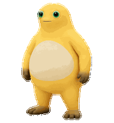

# 奶蛙 · Milofrog

一只黄色、无尾、会捧腹大笑的桌面伙伴。



| 版本 | 下载 |
| --- | --- |
| Codex 智能伙伴 | [Codex 素材包](https://github.com/Wievondii/milofrog/releases/latest/download/milofrog-codex.zip) |
| 独立 Windows 桌宠 | [Milofrog.exe](https://github.com/Wievondii/milofrog/releases/latest/download/Milofrog.exe) |

## Codex 智能伙伴

解压 Codex 素材包。在支持自定义宠物的 Codex 或 ChatGPT Work 客户端里启用 Pets，把 `spritesheet.png` 作为附件，并告诉 Codex：

> 请用我附上的原始精灵图，通过 Pets 创建名叫「奶蛙」的自定义宠物。请验证并使用这张图，保留原有动作帧。

透明 PNG 尺寸为 1536 × 2288，采用 v2 布局，包含 73 帧。宠物状态和播放速度由客户端决定。也可以直接下载仓库里的[原始精灵图](codex/spritesheet.png)。

## 独立 Windows 桌宠

适用于带 .NET Framework 4.x 的 64 位 Windows 10 或 11。EXE 内置图集，可离线运行。

- 单击挥手，双击捧腹大笑。
- 左右拖动时朝对应方向跑，鼠标靠近时转头跟视。
- 约 26 秒无互动后做出等待动作。
- 右键可播放动作、调整大小、切换置顶或退出。

独立版以 30 FPS 时间轴播放，过渡帧由原始图集通过光流补帧生成，跟视使用原来的 16 个方向。

## 从源码构建

在仓库根目录用 PowerShell 运行 `./windows/build.ps1`，生成 `dist/Milofrog.exe`。构建使用系统 .NET Framework 的 C# 编译器，仓库已经包含运行所需的两套图集。

如需更新补帧数据，先安装 Python 依赖，再重新生成图集：

```powershell
python -m pip install pillow numpy opencv-python
python windows/interpolate.py codex/spritesheet.png windows/assets/motion30.png
./windows/build.ps1
```

代码和仓库内的奶蛙素材采用 [MIT 许可](LICENSE)。这是一个独立社区项目。
